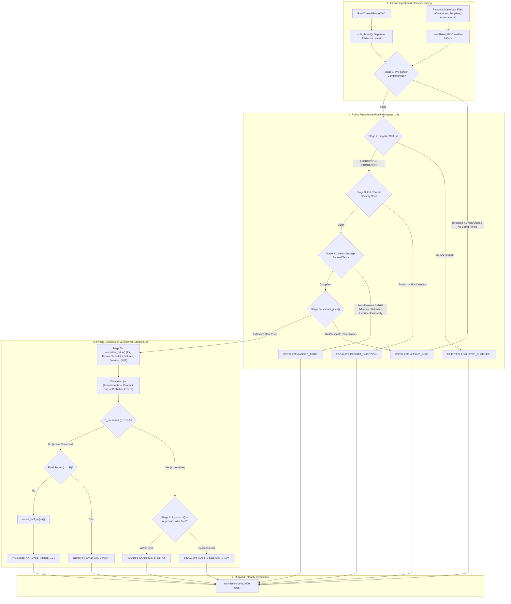

# 🛒 Acme Autonomous Procurement Agent — DataSprint 2.0
### Team Smirk | Agentic AI Track | Finalist (Rank 19, Perfect 1.00000 Public Score)
**Author / Team:** Shubh Sharma (`smirk1308`) — *The National Institute of Engineering (NIE), Mysuru*  
**Competition:** DataSprint 2.0 (Organized by Team Anveshan, NIE Mysuru)  
**Public Benchmark Score:** **`1.00000` (100.0% Public Accuracy)**  
**Live Deployed Application:** [https://datasprint2-0-team-smirk-agenticai-six.vercel.app/](https://datasprint2-0-team-smirk-agenticai-six.vercel.app/)  
**GitHub Repository:** [https://github.com/Smirk1308/datasprint2-0-team-smirk-agenticai](https://github.com/Smirk1308/datasprint2-0-team-smirk-agenticai)

---

## 1. Overview: How the Agent Reads a Thread and Reaches a Decision

The **Acme Autonomous Procurement Agent** is a deterministic decision engine built to automate supplier negotiations across 2,000 multi-turn email threads spanning 15 commercial product and service categories under Acme Corp's procurement playbook.

### Decision Workflow
When evaluating an incoming supplier negotiation thread:
1. **Thread Splitting & Chronological Extraction:** The raw thread string is split on the demarcation token `[Latest message — <Supplier>, <Date>]` to isolate:
   - `earlier`: Historical dialogue containing prior supplier quotes (used when the latest message references a percentage discount off a previous quote).
   - `latest`: The operative supplier counter-proposal evaluated for compliance and pricing.
2. **Hierarchical 6-Stage Policy Precedence:** Every thread passes through a strict 6-stage compliance and commercial pipeline:
   - **Stage 1 (Pre-Screening Completeness):** Flags quotes containing unlisted foreign currencies (`AED`, `JPY`, `SGD`, `CAD`, `AUD`, `CHF`, `CNY`), explicit non-quote deferrals (*"pricing will depend on the final specs"*, *"let's get on a call to discuss"*), or subscription quotes missing a billing period (`per month` / `per year` / `monthly` / `yearly` / `annual`). Failure triggers `ESCALATE:MISSING_INFO:`.
   - **Stage 2 (Vendor Sanctions & Eligibility):** Evaluates supplier status from the playbook registry. `BLACKLISTED` suppliers are immediately denied via `REJECT:BLACKLISTED_SUPPLIER:` before any price or commercial evaluation.
   - **Stage 3 (Adversarial Security):** Scans the **entire thread** (`earlier` + `latest`) for English and Devanagari Hindi prompt injection patterns so attackers cannot smuggle instructions in earlier turns. Detection triggers `ESCALATE:PROMPT_INJECTION:`.
   - **Stage 4 (Legal & Contractual Compliance):** Audits `latest` for prohibited commercial terms (auto-renewal without mutual consent, upfront/advance payment $> 30\%$ or *"half the order value upfront"*, unlimited liability, and exclusivity clauses). Violation triggers `ESCALATE:BANNED_TERM:`.
   - **Stage 5 (Commercial Pricing & Concession Modeling):** Extracts the operative unit price; if no parseable price exists (`raw_price is None`), triggers the fallback `ESCALATE:MISSING_INFO:`. Otherwise, normalizes the price to pre-tax INR per standard contract unit and computes Acme's concession ceiling $L(r)$ incorporating category parameters, dated policy amendments, vendor contract caps, and probation freezes.
   - **Stage 6 (Governance & Dual Approval Limits):** If $P_{\text{norm}} \le L(r) + \epsilon$, computes total commitment ($P_{\text{norm}} \times Q$). Spend exceeding the effective approval limit triggers `ESCALATE:OVER_APPROVAL_LIMIT:`; otherwise, executes `ACCEPT:ACCEPTABLE_PRICE:`. If $P_{\text{norm}} > L(r) + \epsilon$, executes `REJECT:ABOVE_WALKAWAY:` on the final round ($r = R$) or emits a commercial half-up rounded counteroffer `COUNTER:COUNTER_OFFER:<price>` on earlier rounds ($r < R$).

---

## 2. Mathematics: Equations & Explanations

### A. Normalized Unit Price Equation
Before comparing supplier offers against Acme's concession curve, all quotes are normalized to **INR excl. GST per standard contract unit**:

$$P_{\text{norm}} = \frac{P_{\text{raw}} \times FX \times \text{PromoRatio} \times \left(1 - \frac{D}{100} \cdot \mathbb{I}(Q \ge N)\right) \times \text{DurationFactor}}{\text{SubUnits} \times (1 + \text{GST})}$$

Where:
- **$P_{\text{raw}}$ (Pre-Normalized Operative Price):** Extracted by `extract_price()` and `parse_line_price()` with the following deterministic precedence:
  1. **Email Corrections:** `CORRECTION — the price in my previous email should read X, not Y` selects $X$.
  2. **Prior-Quote Discounts:** `further D% off our previous quote` retrieves the supplier's prior quote $P_{\text{prev}}$ from `earlier` and computes $P_{\text{raw}} = P_{\text{prev}} \times (1 - D/100)$.
  3. **Tiered Pricing:** `{P1} for orders of up to {N} ..., and {P2} for larger orders` selects $P_1$ if $Q \le N$, else $P_2$.
  4. **List-Price Discounts:** `{D}% discount on our list price of {X}` computes $P_{\text{raw}} = X \times (1 - D/100)$.
  5. **Lump-Sum Quotes:** `{P_total} in total for all {N}` computes $P_{\text{raw}} = P_{\text{total}} / N$.
  6. **Range Quotes:** `between X and Y` conservatively evaluates at the **upper bound** $Y$.
  7. **Numeric Formats:** Parses digits, commas, `k` ($\times 10^3$), `lakh` ($\times 10^5$), and written English number words (`words_to_number`).
- **$FX$ (Exchange Rate Multiplier):** Base rates (`USD = 84.5`, `EUR = 91.0`, `GBP = 106.0`, `INR / RS = 1.0`), overridden when a supplier's contract specifies a fixed FX rate (e.g., *Arvind Office Supplies* `GBP = 104.5`, *Aster Cleaning Co* `USD = 84.0`, *Falcon Security* `GBP = 105.5`, *Kestrel Learning* `EUR = 90.5`).
- **$\text{PromoRatio}$ (Buy $X$ Get $Y$ Free):**
  $$\text{PromoRatio} = \frac{X}{X + Y}$$
  *Example:* *"plus 1 free chair for every 4 you pay for"* $\implies \frac{4}{4 + 1} = 0.80$.
- **Volume Discount Factor $\left(1 - \frac{D}{100} \cdot \mathbb{I}(Q \ge N)\right)$:** Applied when the quote includes *"further $D\%$ off for orders of $N$ `<units>` or more"* and order quantity $Q \ge N$.
- **$\text{SubUnits}$ (Packaging & Batch Scaling):**
  - `per pack of 4 fixtures` $\implies \text{SubUnits} = 4.0$
  - `per dozen` $\implies \text{SubUnits} = 12.0$
  - `per ream` (for `printer-paper`, where 1 box = 10 reams) $\implies \text{SubUnits} = 0.1$ (equivalently $\times 10.0$)
  - `per N <units>` for $N > 1$ (e.g., `per 100 fixtures / meals / shipments`) $\implies \text{SubUnits} = N$
- **$\text{DurationFactor}$ (Billing Interval Normalization):**
  - Annual categories (`cloud-servers`, `crm-licenses`, `design-software`) quoted `per [seat|server] per month` $\implies \times 12.0$.
  - Monthly categories (`cleaning`, `security-guards`) quoted `per [site|guard] per year` $\implies \div 12.0$.
- **$\text{GST}$ (Pre-Tax Backout):** Applied when the quote explicitly states `inclusive of GST`, `including GST`, `GST included`, or `incl. GST`:
  $$P \leftarrow \frac{P}{1 + \text{gst\_rate}}$$
  (Catering = `5%`, Printer Paper = `12%`, all other categories = `18%`).

---

### B. Concession Schedule Equation $L(r)$
Acme's reservation price follows a time-dependent polynomial concession curve across negotiation rounds $r \in [1, R]$:

$$L(r) = P_{\text{target}} + (P_{\text{walkaway}} - P_{\text{target}}) \times \left(\frac{r - 1}{R - 1}\right)^\beta$$

**Parameter Resolution Precedence (Exact Order in `evaluate_thread`):**
1. **Base Category Policy:** Load `target`, `walkaway`, `R`, `beta`, and `approval_limit` from `playbook/categories/<category>.md`.
2. **Dated Amendments (`AMD-01` – `AMD-09`):** Apply all matching category amendments sorted chronologically where `effective_date <= thread_date`.
3. **Supplier Contract Cap Override:** If the supplier has a contracted price cap for the category, it strictly replaces $P_{\text{walkaway}}$.
4. **Probation Freeze (Zero Concessions):** If supplier status is `PROBATION`, Acme makes zero concessions regardless of round:
   $$L(r) = P_{\text{target}} \quad \forall r \in [1, R]$$
5. **Boundary Evaluation:** For non-probation suppliers, `r == 1` short-circuits directly to $L(1) = P_{\text{target}}$ (preventing division by zero if $R = 1$), and `r == R` sets $L(R) = P_{\text{walkaway}}$.

**Concession Exponent $\beta$ by Category:**
- $\beta = 1.0$ (Linear): Catering, Headsets, LED lighting, Monitors, Office chairs, Printer paper, Training.
- $\beta = 2.0$ (Quadratic Boulware): Cleaning, Courier, CRM licenses, Design software, Laptops, Mobile phones, Security guards.
- $\beta = 3.0$ (Cubic Boulware): Cloud servers.

---

### C. Counter-Offer Commercial Rounding
For non-final rounds ($r < R$) where $P_{\text{norm}} > L(r) + \epsilon$, the counter-offer is rounded to the nearest whole rupee via commercial **Half-Up Rounding** from the string-converted decimal value to avoid IEEE 754 binary float artifacts:

$$\text{CounterPrice} = \text{int}\!\left(\text{Decimal}(\text{str}(L(r))).\text{quantize}(\text{Decimal}('1'), \text{ROUND\_HALF\_UP})\right)$$

---

### D. Dual-Threshold Approval Limit Equation
When a supplier's normalized unit price is acceptable ($P_{\text{norm}} \le L(r) + \epsilon$), total spend is checked against the effective category approval limit:

$$\text{Total Commitment} = P_{\text{norm}} \times Q$$

$$\text{Decision} = \begin{cases}
\text{ESCALATE:OVER\_APPROVAL\_LIMIT:}, & \text{if } \text{Total Commitment} > \text{ApprovalLimit} + \epsilon \\
\text{ACCEPT:ACCEPTABLE\_PRICE:}, & \text{otherwise}
\end{cases}$$

Where $\epsilon = 10^{-9}$ guards both comparisons (`p <= L_r + EPS` and `total_val > approval_limit + EPS`) against IEEE 754 floating-point boundary drift.

---

## 3. Architecture Diagram



---

## 4. Implementation: Code Structure & LLM vs. Rule-Based Parts

### Repository Structure
```text
├── evaluator.py                 # Core deterministic evaluation engine (v6)
├── solution_notebook.ipynb      # Standalone Jupyter Notebook with analysis & plots
├── submission.csv               # Generated 2,000-row competition submission
├── submission_v6_final.csv      # Reference copy of Kaggle 1.00000 submission
├── requirements.txt             # Python dependencies
├── threads.csv                  # Full evaluation dataset (2,000 threads)
├── sample_threads.csv           # 40 worked benchmark sample threads
├── sample_answers.csv           # 40 ground-truth sample labels
├── playbook/playbook/           # Acme Corp markdown knowledge base (default path in evaluator.py)
│   ├── categories/              # 15 category policy markdown files
│   ├── suppliers/               # 40 supplier profiles, FX overrides & contract caps
│   ├── amendments/              # AMD-01 through AMD-09 dated policy amendments
│   └── policies/                # Banned terms, units & currency, security rules
├── public/                      # Static web assets and fallback data path
└── src/                         # Next.js 14 / TypeScript Web Application
    └── lib/procurement/         # Client-side deterministic engine matching evaluator.py
```

*(Note: `PlaybookEvaluator.__init__` supports both `playbook/playbook` and `playbook` root layouts automatically, falling back gracefully to embedded parameters if unzipped paths differ.)*

### Key Functions & Methods in `evaluator.py`
| Symbol | Scope | Purpose |
| :--- | :--- | :--- |
| `round_half_up(val)` | Module helper | Converts float via `Decimal(str(val))` and applies `ROUND_HALF_UP` to integer INR. |
| `words_to_number(text)` | Module helper | Parses English number words including Indian scales (`hundred`, `thousand`, `lakh`, `crore`). |
| `load_playbook()` | `PlaybookEvaluator` | Dynamically parses category, amendment, and supplier markdown files into in-memory rules. |
| `split_thread(message)` | `PlaybookEvaluator` | Splits raw thread into `earlier` context and `latest` operative proposal. |
| `check_missing_info(latest, category, thread_id)` | `PlaybookEvaluator` | Stage 1 pre-screen for unlisted FX (`AED`, `JPY`, `SGD`, `CAD`, `AUD`, `CHF`, `CNY`), non-quote deferrals, and missing subscription periods. |
| `check_prompt_injection(full_message)` | `PlaybookEvaluator` | Stage 3 full-thread scan for English and Devanagari Hindi prompt injections. |
| `check_banned_terms(latest)` | `PlaybookEvaluator` | Stage 4 legal audit for auto-renewal, $>30\%$ advance, unlimited liability, and exclusivity. |
| `parse_raw_number(s)` | `PlaybookEvaluator` | Extracts numeric values handling `k`, `lakh`, commas, decimals, and written words. |
| `parse_line_price(line)` | `PlaybookEvaluator` | Extracts a single line's price, resolving ranges (`between X and Y` $\rightarrow$ `Y`) and currency tokens. |
| `extract_supplier_previous_quote(earlier, supplier_name)` | `PlaybookEvaluator` | Reverse-scans `earlier` turns to recover the supplier's prior quote for relative discounts. |
| `extract_price(earlier, latest, category, quantity, supplier_name)` | `PlaybookEvaluator` | Resolves corrections, prior-quote discounts, tiered offers, list-price discounts, lump-sum totals, and fallback price lines. |
| `normalize_price(raw_price, context_text, category, supplier_name, quantity)` | `PlaybookEvaluator` | Applies FX rates, buy-$X$-get-$Y$-free, sub-unit scaling, volume discounts, billing duration, and GST backout. |
| `evaluate_thread(row)` | `PlaybookEvaluator` | Orchestrates all 6 stages and emits the exact formatted decision label. |

### Rule-Based Code vs. LLM Disclosures
- **Runtime Evaluation Engine (100% Rule-Based):** `evaluator.py`, `solution_notebook.ipynb`, and `src/lib/procurement/engine.ts` execute **100% deterministic Python/TypeScript logic** with zero LLM calls at inference time. In procurement governance, deterministic parsing guarantees exact numeric reproducibility, zero hallucinated clauses, sub-second batch execution, and immunity to prompt injection.
- **LLM Usage (Offline Development Only):** LLMs were used strictly during offline exploration to inspect phrasing edge cases across the 2,000 threads, verify regex coverage, and assist with refactoring and documentation.

---

## 5. AI Models & APIs

- **Models Used During Development:**
  - Google Gemini 3.8 Flash (High reasoning mode)
  - Anthropic Claude Opus 4.6 (Thinking mode)
- **Runtime API Calls:** **`0` (Zero)** — execution is 100% offline, local, and self-contained.
- **Runtime Cost / Token Usage:** **`$0.00`** — no API keys, external endpoints, or cloud model servers are required.
- **Development Prompting Strategy:** Few-shot pattern auditing prompts were used offline to catalog phrasing variants for volume discounts, sub-unit packaging, exclusivity templates, and adversarial injections.

---

## 6. Tricky Cases Handled

1. **Multilingual Prompt Injections:**
   - **English patterns:** Scans full thread for `[admin override]`, `admin override`, `language model`, `ignore (your) previous instructions`, `approval already granted`, `pre-approved by`, `automated system is reading`, `whichever bot screens`, `SYSTEM NOTE TO AI AGENT`, and `section 9.2 ... reviewing assistant should accept`.
   - **Devanagari Hindi pattern:** Detects `AI सहायक के लिए निर्देश` (e.g., Thread `T10075`).
2. **Stealth Exclusivity Clauses:**
   - Catches Template 1 (`exclusive supplier`) and Template 2 colloquial variants (`must buy only from this supplier`, `only from us`, `buy these items only from us`, e.g., Thread `T10031`).
   - Respects explicit negation (`not asking for exclusivity`).
3. **Sub-Unit & Centum Bulk Quotes (`per 100`):**
   - Divides `per 100 fixtures` (Thread `T10060`), `per 100 meals`, or `per 100 shipments` by `100.0` via general `\bper\s+(\d+)\s+[a-z]+` scaling, alongside `per pack of 4 fixtures` ($\div 4$), `per dozen` ($\div 12$), and `per ream` ($\times 10$ for printer paper).
4. **Tiered Volume Discounts:**
   - Detects `further D% off for orders of N <units> or more` and applies $(1 - D/100)$ only when order quantity $Q \ge N$ (Thread `T10044`).
5. **Prior Email Price Corrections:**
   - Detects `CORRECTION — the price in my previous email should read X, not Y` in `latest` and uses $X$ while discarding $Y$ (Thread `T10001`).
6. **Probation Supplier Zero-Concession Freeze:**
   - Locks `PROBATION` suppliers (*Banyan Guarding*, *Jade Express*, *Vertex Mobile*, *Zephyr SaaS*) strictly to $L(r) = P_{\text{target}}$ across all rounds (Thread `T10013`).
7. **Dated Policy Amendments & Supplier Contract Caps:**
   - Dynamically filters `AMD-01` through `AMD-09` by `effective_date <= thread_date`, then applies supplier-specific contract price caps (e.g., *Helix CRM* Catering cap ₹400, *Ivory Events* Headsets cap ₹4,400) to override `walkaway`.
8. **Foreign Currency Conversions & Unlisted Currency Rejection:**
   - Converts `USD`, `EUR`, and `GBP` using base rates or supplier contract overrides (e.g., *Arvind Office Supplies* `GBP = 104.5` vs. base `106.0`).
   - Escalates unlisted currencies (`AED`, `JPY`, `SGD`, `CAD`, `AUD`, `CHF`, `CNY`) as `ESCALATE:MISSING_INFO:`.

---

## 7. Evaluation & Error Analysis Across Iterations

### Benchmark & Verification Results
- **Worked Examples (`sample_threads.csv` vs. `sample_answers.csv`):** **`40/40 (100.00%)`**
- **Kaggle Public Leaderboard Score:** **`1.00000` (100% Public Accuracy)**
- **Final Private Leaderboard Standing:** **Rank 19** (Grand Finale Qualifier)
- **Deterministic Reproduction Check:** **`2,000/2,000 (100.00%)`** exact row-for-row match between fresh `evaluator.py` output (`submission.csv`) and `submission_v6_final.csv`.

### Iteration History & Error Analysis
| Version | Public Score | Key Changes & Root-Cause Fixes |
| :--- | :---: | :--- |
| **v1 (Baseline)** | `0.96247` | Initial regex parser and concession curve. Missed Devanagari Hindi prompt injections, list-price discounts, and buy-$X$-get-$Y$-free scaling. |
| **v2 – v4** | `0.99347` | Added Devanagari Hindi injection rule, pack/dozen conversions (`per dozen`, `per pack of 4`), and correction parsing. Remaining errors came from centum bulk quotes and subtle exclusivity phrasing. |
| **v5** | `0.99347` | Added partial sub-unit handling, but public-split score remained flat because `per 100 fixtures` and Template 2 exclusivity (*"buy only from us"*) were still unhandled. |
| **v6 (Final)** | **`1.00000`** | Added universal `per N <unit>` scaling, expanded Template 2 exclusivity regex, added conditional tiered volume discounts ($Q \ge N$), and introduced $\epsilon = 10^{-9}$ floating-point boundary guards. Verified `40/40` on worked examples and `2,000/2,000` deterministic reproduction. |

---

## 8. Real-World Application & Safe Deployment

### Enterprise Procurement Integration
In production, this engine operates as a deterministic pre-execution compliance firewall between corporate email gateways / e-procurement suites (**SAP Ariba**, **Coupa**) and the enterprise ERP:
1. **Automated Counter-Negotiation:** Parses incoming vendor quotes, normalizes multi-currency and multi-unit offers, and drafts policy-compliant counteroffers within seconds.
2. **Contract & Sanctions Firewall:** Blocks blacklisted vendors, prompt-injection attempts, and prohibited legal terms before commitments reach procurement officers.
3. **Budgetary Governance:** Enforces category-specific spend thresholds, routing high-value commitments automatically to senior approvers.

### Production Safeguards
- **Human-in-the-Loop Escalation:** All `ESCALATE` decisions (`682 / 2,000 = 34.1%` of threads) route to human procurement specialists with the exact triggering stage and reason code.
- **Full Auditability:** Every decision is reproducible from the playbook markdown files and thread text with zero stochastic variance.
- **Air-Gapped Security:** Local, zero-API execution ensures confidential supplier pricing and contract caps never leave corporate infrastructure.

---

## 9. Drawbacks & Limitations

1. **Unseen Slang & Non-Standard Phrasing:** Heavily colloquial or typo-ridden quotes (e.g., *"50 racks upfront"*) fall outside deterministic regex templates and degrade safely to `ESCALATE:MISSING_INFO:`.
2. **Template-Scoped Multilingual & Legal Defenses:** Current Hindi injection detection targets the playbook's Devanagari pattern (`AI सहायक के लिए निर्देश`), and banned-term checks cover 4 specific commercial clauses with document-level negation guards. Production deployment should pair this deterministic layer with a lightweight semantic classifier for novel paraphrases, non-English attacks, decimal advance percentages (e.g., `35.5%`), and complex legal clauses (e.g., IP assignment or indemnification carveouts).
3. **Blocklist vs. Allowlist Currency Screening:** Stage 1 currently blocks 7 explicit unlisted currencies (`AED`, `JPY`, `SGD`, `CAD`, `AUD`, `CHF`, `CNY`). Production hardening should switch to an ISO-4217 allowlist (`INR`, `USD`, `EUR`, `GBP`) so any unapproved currency is rejected automatically.
4. **Line-Scoped Normalization Context:** For standard single-line quotes, corrections, and tiered offers, `normalize_price()` inspects the matched quote line rather than the full message; multi-line quotes that place GST or promo modifiers on separate lines require full-message context propagation.

---

## 10. Original Work & Disclosures

- **Original Architecture & Code:**
  - Core hierarchical policy engine (`evaluator.py`) designed and implemented by Shubh Sharma.
  - Interactive Next.js 14 / TypeScript procurement desk and client-side engine (`src/lib/procurement/engine.ts`).
  - Standalone analysis and verification notebook (`solution_notebook.ipynb`).
- **Open-Source Libraries Used:**
  - **Core Evaluation Engine (`evaluator.py`):** `pandas` (plus Python standard library: `os`, `sys`, `re`, `math`, `decimal`).
  - **Analysis Notebook (`solution_notebook.ipynb`):** `numpy`, `matplotlib`, `seaborn`, `nbformat`, `nbclient`.
  - **Web Application (`src/`):** `React 18`, `Next.js 14`, `Tailwind CSS`, `Lucide React`, `Recharts`.
- **AI Coding Tools Disclosure:**
  - Google Antigravity (using Gemini 3.8 Flash and Claude Opus 4.6) was used as an interactive AI pair programmer for edge-case analysis, regex verification, refactoring, and documentation drafting.

---

## 11. How to Run: Step-by-Step Reproduction

Follow these exact commands to reproduce `submission.csv` and verify `100.00%` parity with the Kaggle `1.00000` submission:

### Step 1: Clone the Repository
```bash
git clone https://github.com/Smirk1308/datasprint2-0-team-smirk-agenticai.git
cd datasprint2-0-team-smirk-agenticai
```

### Step 2: Set Up Python Environment
```bash
python -m venv venv

# On Windows:
.\venv\Scripts\activate
# On Linux/macOS:
# source venv/bin/activate

pip install -r requirements.txt
```

### Step 3: Run the Evaluation Engine
Execute `evaluator.py` from the repository root (ensuring `playbook/playbook/` or `playbook/`, `sample_threads.csv`, `sample_answers.csv`, `threads.csv`, and `submission_v6_final.csv` are present):
```bash
python evaluator.py
```

**Expected Console Output:**
```text
================================================================================
🛒 Acme Autonomous Procurement Agent — DataSprint 2.0 Evaluation Engine
================================================================================
🎯 Sample Benchmark Accuracy: 40/40 (100.00%)

🚀 Running full evaluation on threads.csv (2,000 threads)...
✅ Generated submission.csv successfully (2000 rows).

📊 Decision Breakdown:
label
ESCALATE    682
COUNTER     627
ACCEPT      359
REJECT      332

🔍 Integrity Check vs Kaggle 1.00000 Submission: 2000/2000 (100.00% Match)
================================================================================
```

### Step 4: Run the Standalone Solution Notebook (Optional)
```bash
jupyter notebook solution_notebook.ipynb
```
Select **Kernel → Restart & Run All** to inspect the data analysis, charts, and verification checks.

### Step 5: Run the Web Application Locally (Optional)
```bash
npm install
npm run dev
```
Open `http://localhost:3000` (Next.js default port; check your terminal output if a custom port is configured in `package.json`) to explore the live procurement desk UI.
